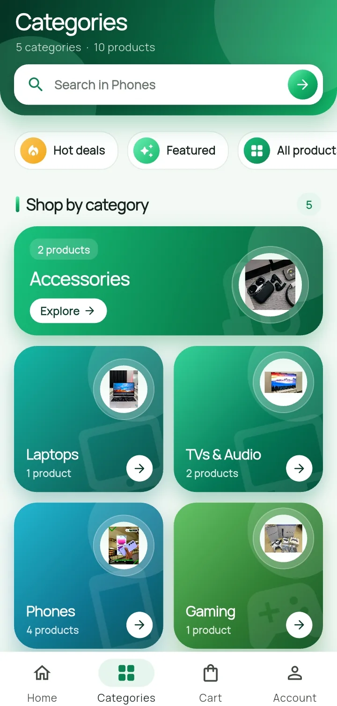
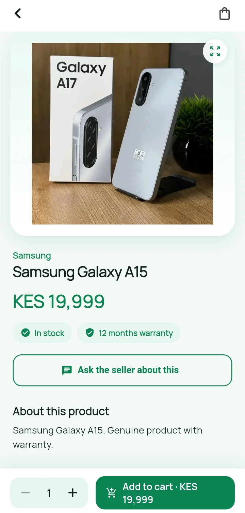
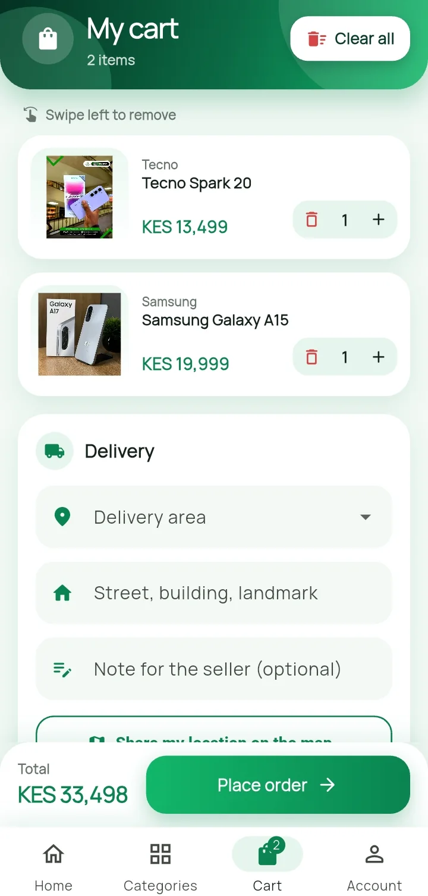
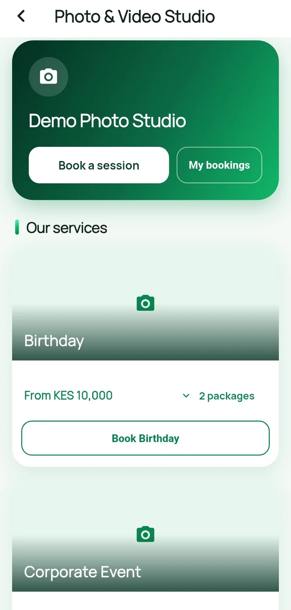
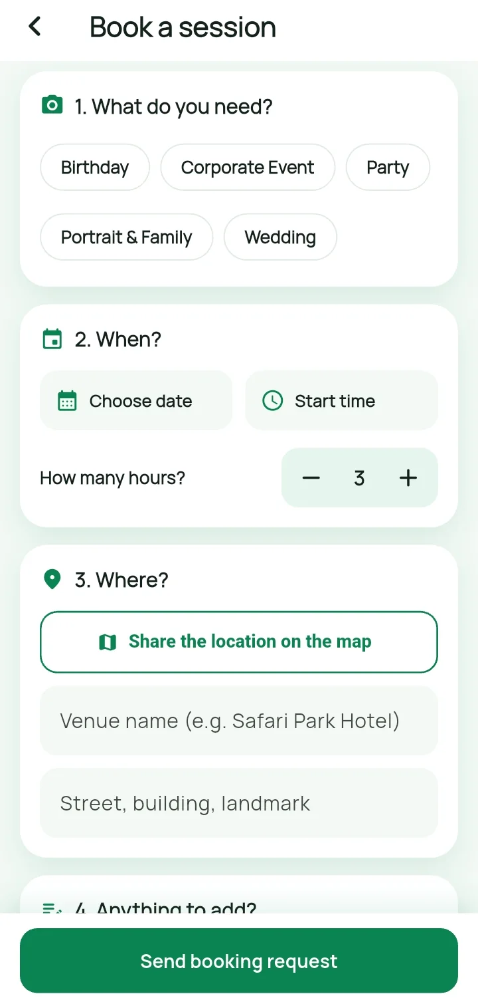

<div align="center">


# Tela Globe

**Shop electronics. Book your photo session.**

An Android app to order phones, laptops and TVs with delivery,<br>and to book photo and video sessions, all in one place.

<br>

[](https://github.com/iam-orly-bertin/tela_globe/releases/latest/download/telaglobe.apk)
[](https://iam-orly-bertin.github.io/tela_globe/)


</div>

<br>

<div align="center">
  &nbsp;
  &nbsp;
  &nbsp;
  &nbsp;
  
</div>

<br>

## About

Tela Globe brings two services into one app: a shop for electronics delivered to your area, and a studio where you book photo and video sessions on the day you choose. Orders and bookings can be sent straight to the seller on WhatsApp and followed from inside the app.

The official download page is here: **https://iam-orly-bertin.github.io/tela_globe/**

## Features

| Shop | Order |
|---|---|
| Search, categories, hot deals and brands<br>Price, stock and warranty shown before you buy | Delivery to your area with the total up front<br>Send your order on WhatsApp and track its status |

| Studio | Account |
|---|---|
| Weddings, birthdays, events and portraits<br>Pick the service, date and place, then follow it in My bookings | Log in with email or Google<br>Create an account in under a minute |

## Install

> The app is not on the Play Store yet, so Android asks a few extra questions. This is normal.

1. **Download** the APK from the [download page](https://iam-orly-bertin.github.io/tela_globe/) or the button above.
2. **Open the file.** If Android blocks it, tap *Settings* and allow your browser to *install unknown apps*, then go back.
3. If **Play Protect** warns you, tap *More details*, then *Install anyway*.
4. **Open Tela Globe**, create your account and start.

## Good to know

- Android only. iPhone is not supported yet.
- Install the app only from the download page or from this repository's releases.
- The first opening can take up to a minute because the server sleeps when nobody uses it. After that it is fast.

## Support

Questions or problems? Use the WhatsApp button on the [download page](https://iam-orly-bertin.github.io/tela_globe/).

<br>

<details>
<summary><b>For the site owner</b></summary>

<br>

The download page is a static site served with GitHub Pages. The APK is not stored in the repository: it lives in GitHub Releases.

```
index.html                  the page
css/style.css               the design
js/main.js                  the behaviour (settings at the top)
assets/screenshots/*.webp   phone screenshots (720x1504)
assets/favicon.svg          browser tab icon
```

**Publish a new version**

1. Go to Releases, then Create a new release.
2. Set the tag (for example `v1.1`) and the title (for example `Tela Globe 1.1`).
3. Attach the APK named exactly `telaglobe.apk`.
4. Publish the release. Do not tick "pre-release".

The page reads the latest release and updates the version, size and date by itself.

**Test on your computer**

```
python3 -m http.server 8080
```

Then open `http://localhost:8080`.

</details>

<div align="center">

<sub>&copy; Tela Globe. All rights reserved.</sub>

</div>